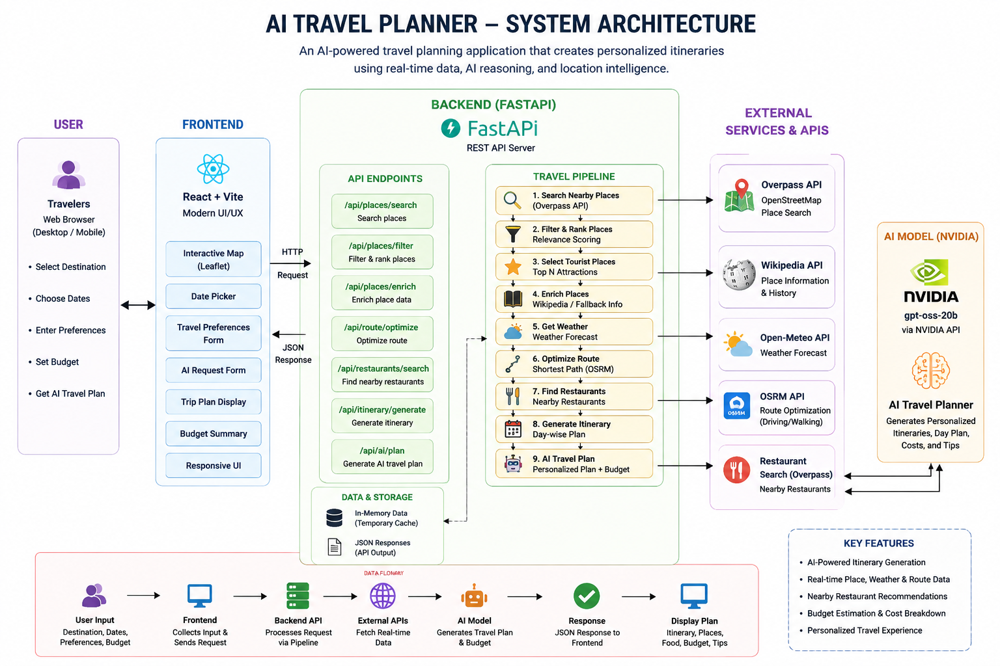

```markdown
# 🤖 AI Travel Planner

An AI-powered travel planning application that creates personalized, budget-aware travel itineraries using real-time location data, weather information, route optimization, nearby restaurants, and a Groq-hosted LLM.

The application is designed to take a traveler's destination, dates, preferences, number of travelers, and budget, then generate a practical day-by-day travel plan.

---

## 🔗 Live Links & Demo

- **Frontend (Vercel):** [https://ai-travel-planner-five-theta.vercel.app](https://ai-travel-planner-five-theta.vercel.app)
- **Backend (Render):** [https://ai-travel-planner-1-qxvb.onrender.com](https://ai-travel-planner-1-qxvb.onrender.com)
- **Backend Health Check:** [https://ai-travel-planner-1-qxvb.onrender.com/health](https://ai-travel-planner-1-qxvb.onrender.com/health)

---

# 🎥 Project Demo

The uploaded screen recording demonstrates the AI Travel Planner interface and a **personalized budget-aware itinerary** workflow.

### Demo video


[▶️ Watch the full-quality demo video](VIDEO/Watch%20Demo%20Video.mp4)

The demonstrated workflow includes:

1. User selects destination, travel dates, budget, and preferences.
2. Backend runs the 9-step travel pipeline (places, weather, route optimization, and nearby restaurants).
3. Groq LLM (`openai/gpt-oss-120b`) generates the structured day-by-day itinerary and cost breakdown.

---

## 📌 Project Overview

The AI Travel Planner combines traditional backend services with an LLM to produce a personalized itinerary.

The user provides:

- Destination
- Trip start and end dates
- Number of travelers
- Total budget
- Travel preferences
- Food preferences
- Walking/travel requirements
- Additional instructions in natural language

The backend then collects and processes travel data before sending the relevant information to the AI model.

The final response contains:

- Recommended attractions
- Historical/background information
- Reasons to visit
- Things to see
- Daily itinerary
- Nearby restaurants
- Approximate food costs
- Attraction costs
- Transportation costs
- Daily cost estimates
- Complete trip budget
- Remaining budget
- Budget status
- Practical travel tips

---

## 🏗️ System Architecture



*High-level architecture of the AI Travel Planner, showing the frontend, FastAPI backend, travel pipeline, external services, Groq LLM, and final travel-plan response.*

### High-Level Flow

```text
                    ┌─────────────────────┐
                    │        USER         │
                    │ Destination         │
                    │ Dates               │
                    │ Preferences         │
                    │ Travelers + Budget  │
                    └──────────┬──────────┘
                               │
                               ▼
                    ┌─────────────────────┐
                    │ React + Vite        │
                    │ Frontend            │
                    │                     │
                    │ Map / Forms / Plan  │
                    │ Budget Display      │
                    └──────────┬──────────┘
                               │ HTTP / JSON
                               ▼
              ┌──────────────────────────────────┐
              │          FastAPI Backend         │
              │                                  │
              │          Travel Pipeline         │
              │                                  │
              │  1. Search Places                │
              │  2. Filter / Rank                │
              │  3. Select Attractions           │
              │  4. Enrich Place Information     │
              │  5. Get Weather                  │
              │  6. Optimize Route               │
              │  7. Find Restaurants             │
              │  8. Generate Itinerary           │
              │  9. Generate AI Travel Plan      │
              └──────────────┬───────────────────┘
                             │
             ┌───────────────┼──────────────────┐
             │               │                  │
             ▼               ▼                  ▼
      ┌────────────┐  ┌──────────────┐  ┌──────────────┐
      │ Overpass / │  │ Open-Meteo   │  │ OSRM         │
      │ Nominatim  │  │ Weather API  │  │ Route API    │
      │ OpenStreet │  │              │  │              │
      │ Map data   │  │              │  │              │
      └────────────┘  └──────────────┘  └──────────────┘
             │
             ▼
      ┌──────────────┐
      │ Wikipedia /  │
      │ fallback     │
      │ information  │
      └──────────────┘

                             │
                             ▼
                  ┌──────────────────────┐
                  │ Groq API             │
                  │                      │
                  │ openai/gpt-oss-120b  │
                  │                      │
                  │ Generates structured │
                  │ travel recommendation│
                  └──────────┬───────────┘
                             │
                             ▼
                  ┌──────────────────────┐
                  │ JSON Response        │
                  │                      │
                  │ Itinerary + Budget   │
                  │ Restaurants + Tips   │
                  └──────────┬───────────┘
                             │
                             ▼
                  ┌──────────────────────┐
                  │ React Travel Plan UI │
                  └──────────────────────┘

```

---

## 🔄 9-Step Travel Planning Pipeline

1. **Search Nearby Places:** Queries OpenStreetMap data via Overpass API (with Nominatim geocoding/search fallback) to find candidate points of interest around the destination.
2. **Filter & Rank Places:** Filters out invalid or low-value entries and scores places by relevance to the user's travel preferences and trip duration.
3. **Select Attractions:** Picks the top attractions suited to the number of days, pace, and walking/travel preferences.
4. **Enrich Place Information:** Fetches summaries, historical context, and highlights from Wikipedia (with built-in fallback details when articles are unavailable).
5. **Get Weather:** Retrieves forecast/weather conditions for the destination and travel window via Open-Meteo.
6. **Optimize Route:** Computes travel distances and routing order between stops using OSRM to keep daily movement practical.
7. **Find Restaurants:** Searches nearby dining options matching food preferences and budget constraints via Overpass/Nominatim.
8. **Generate Itinerary:** Organizes selected attractions, weather context, route flow, and dining options into a structured day-by-day schedule.
9. **Generate AI Travel Plan:** Sends the structured pipeline context and user requirements to Groq (`openai/gpt-oss-120b`) to produce the final personalized itinerary, cost breakdown, budget status, and travel tips.

---

## 🌐 External Services & AI Model

| Component / Service | Role in AI Travel Planner |
| --- | --- |
| **Overpass API & Nominatim** | Destination geocoding, attraction discovery, and nearby restaurant lookup from OpenStreetMap |
| **Wikipedia API** | Place background, historical notes, and travel highlights (with fallback summaries) |
| **Open-Meteo API** | Weather conditions to support daily planning and packing/activity context |
| **OSRM API** | Route distances and travel time optimization across stops |
| **Groq API (`openai/gpt-oss-120b`)** | Generates structured travel recommendations, day-by-day plans, cost estimates, and tips |

---

## 🛠️ Tech Stack & Hosting

* **Frontend:** React + Vite, Leaflet (interactive map), responsive UI components — hosted on **Vercel**
* **Backend:** Python, FastAPI REST API, 9-step travel pipeline, in-memory caching, configurable CORS (`ALLOWED_ORIGINS`) — hosted on **Render**
* **AI Inference:** Groq API (`openai/gpt-oss-120b`)

---

## 🚀 Local Setup & Running the Project

### 1. Clone the Repository

```bash
git clone [https://github.com/srisai1715-coder/AI-Travel-Planner.git](https://github.com/srisai1715-coder/AI-Travel-Planner.git)
cd AI-Travel-Planner

```

### 2. Backend Setup (FastAPI)

```bash
cd backend
python -m venv .venv
# Windows (PowerShell):
.venv\Scripts\Activate.ps1
# macOS / Linux:
# source .venv/bin/activate

pip install -r requirements.txt

```

Create a `.env` file in `backend/` with your Groq API key and allowed origins:

```env
GROQ_API_KEY=your_groq_api_key_here
ALLOWED_ORIGINS=http://localhost:5173,[https://ai-travel-planner-five-theta.vercel.app](https://ai-travel-planner-five-theta.vercel.app)

```

Start the backend server:

```bash
uvicorn app.main:app --reload

```

### 3. Frontend Setup (React + Vite)

Open a second terminal in the `frontend/` folder:

```bash
cd frontend
npm install

```

Create a `.env` file in `frontend/` pointing to your backend URL:

```env
VITE_API_BASE_URL=[http://127.0.0.1:8000](http://127.0.0.1:8000)

```

Start the frontend development server:

```bash
npm run dev

```

---

## ☁️ Deployment Notes

* **Frontend (Vercel):** Deployed from the `frontend/` directory with `VITE_API_BASE_URL` configured to point to the Render backend URL (`https://ai-travel-planner-1-qxvb.onrender.com`).
* **Backend (Render):** Deployed as a web service running FastAPI, with `GROQ_API_KEY` set in Render environment variables and `ALLOWED_ORIGINS` allowing the Vercel frontend domain. *(Note: On free/starter instances, cold starts may take a few seconds on the first request.)*

---

## 📁 Repository Structure

```text
AI-Travel-Planner/
├── backend/                  # FastAPI application, 9-step pipeline, and API integrations
├── frontend/                 # React + Vite UI, Leaflet map, and itinerary display
├── VIDEO/                    # Demo video (Watch Demo Video.mp4) and demo GIF
├── AI-Travel-Planner-Architecture.png
└── README.md

```

```

```